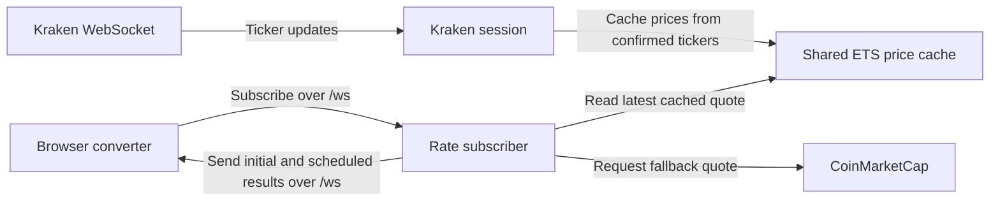

# rates 💹

A cryptocurrency and fiat currency converter with periodic WebSocket quotes, built with [Gleam](https://gleam.run/).
Check it out at [rates.fly.dev](https://rates.fly.dev/?state=v1%3A1-2781%3B1027-2781%3B2010-2781).


## Features

- **Multiple converters** let you track several currency pairs on one page.
- **Rate updates** use Kraken prices when available and fall back to CoinMarketCap.
- **Shareable URLs** save your currency pairs and amounts in the `state` query parameter.
- **Light and dark themes** can be switched from the page header.

## Local development

Requires Gleam, Erlang/OTP, rebar3, Node.js, and npm. CI toolchain versions
are recorded in the repository. [Test workflow](.github/workflows/run-tests.yml)

Install the client npm dependencies from the repo root and rerun this command when they change.

```sh
npm ci --prefix client
```

Set the required variables in `server/.env` using shell assignments, or export
them in your shell.

| Variable | Default | Purpose |
| --- | --- | --- |
| `SECRET_KEY_BASE` | Required | Secret used by Wisp's HTTP handler. |
| `COIN_MARKET_CAP_API_KEY` | Required | API key for the startup catalog, symbol lookups, and fallback conversions. |
| `CRYPTO_LIMIT` | `100` | Maximum results requested per CoinMarketCap cryptocurrency lookup. |
| `SUPPORTED_FIAT_SYMBOLS` | `USD` | Comma-separated fiat symbols to include in the catalog. |
| `LOG_LEVEL` | `info` | Minimum log level. Values are `error`, `warn`, `info`, and `debug`. |

Run from the repo root.

```sh
./dev
```

This builds the client assets into `server/priv/static`, loads `server/.env` if
present, and starts the server on port 8080. Open the app once startup completes.
Stop with Ctrl+C and rerun after making changes. [Local app](http://localhost:8080)

## Tests

Run all test suites from the repo root.

```sh
./test
```

This runs `shared` on Erlang and JavaScript, `client` on JavaScript, and `server`
on Erlang. It stops at the first failing suite.

## Architecture

```text
rates/
├── client/    # Lustre browser app compiled to JavaScript
├── server/    # HTTP, WebSocket, and data provider integrations on Erlang/OTP
└── shared/    # Currency types, URL state, and WebSocket message formats
```

### Startup and currency lookup

The currency service loads the initial crypto and fiat catalog from CoinMarketCap
into an in-memory repository and starts a symbol cache backed by that repository.
The server connects to Kraken's WebSocket v2 API, waits for supported pairs, and
then starts Mist with the currency services and the rate subscriber factory.

`GET /` serves the converter page as HTML, with the currency catalog and initial
converter settings embedded as JSON for the Lustre app.

`GET /api/currencies?symbol=BTC` looks up currencies by symbol. On a cache miss,
it fetches matching cryptocurrencies from CoinMarketCap and stores them in the
same repository that rate subscribers use to look up currency IDs.

### Rate flow



- Each browser WebSocket has one subscriber actor per subscription ID. The
  Kraken session tracks the reference count and upstream status for each symbol.
  Subscribers share one upstream ticker until the last reference is released.
- A subscriber tries the first quote immediately. It uses CoinMarketCap when
  the Kraken pair or a usable cached quote is unavailable. It schedules the next
  refresh after 10 seconds for Kraken or 30 seconds for CoinMarketCap and checks
  for a return to Kraken on each CoinMarketCap refresh.
- After a Kraken disconnect, the session rediscovers supported pairs and replays
  remaining interest. Cached quotes retain their provider timestamps across the
  outage. Delisting removes the cached quote. The browser reconnects to `/ws`
  independently and resubscribes its converters.

## Tech stack

- Browser UI uses [Lustre](https://github.com/lustre-labs/lustre), JavaScript FFI, [Tailwind CSS](https://tailwindcss.com/), and [daisyUI](https://daisyui.com/).
- The server uses [Wisp](https://github.com/gleam-wisp/wisp), [Mist](https://github.com/rawhat/mist), and [Gleam OTP](https://github.com/gleam-lang/otp).
- Market data comes from the [Kraken WebSocket API](https://docs.kraken.com/api/) and the [CoinMarketCap API](https://coinmarketcap.com/api/).
- The [Dockerfile](Dockerfile) packages the compiled server and browser assets for deployment on [Fly.io](https://fly.io/).
